<div align="center">

# 用户中心 · User Center

**v0.1.0** · 一个可以直接跑起来的前后端分离「用户中心」

注册登录 · 个人资料 · 头像裁剪 · 登录设备管理 · 角色权限 · 操作审计 · 站内通知

`Java 21` · `Spring Boot 3.5` · `MySQL 8` · `Vue 3.5` · `Vite 7` · `TypeScript`

</div>

---

## 这是什么

一个**能跑、有测试、有文档**的用户中心，不是脚手架 demo：真的连 MySQL、真的签发 JWT、真的有审计留痕。
界面刻意避开了模板脸——不用 Element Plus / Ant Design，自己写了一套设计变量与小控件，
视觉方向是「个人档案册」：暖白纸面、1px 细线、印章式状态、等宽的数据行。

> **关于版本**：这是 **v0.1.0**。功能已经跑通并且有测试兜着，但接口和界面**还会改**（不保证向后兼容）。
> 用的时候发现任何问题——跑不起来、设计不对味、代码写得不好、文档有错——都欢迎到
> [Issues](https://github.com/VekearYi/user-center/issues) 提出来，我会一条条看。

## 界面

**登录 / 注册**：左侧是深墨封面 + 横格纸 + 卷号，右侧是纸面表单，不是居中小卡片。

| 登录 | 注册 |
|---|---|
| 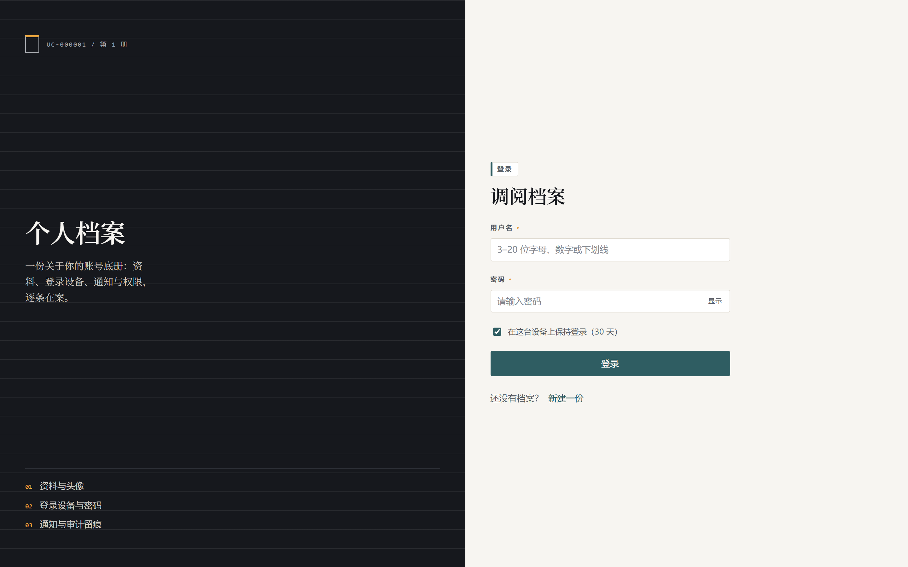 | 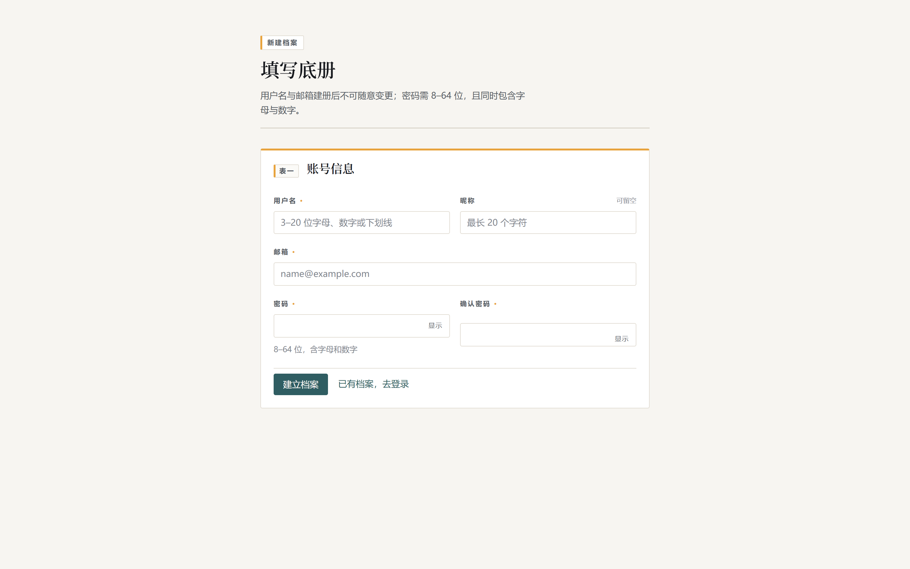 |

**我的档案**：资料页做成底册（ledger）——1px 细线分隔、值全部等宽、最近登录「相对 + 绝对」双写。

| 个人资料 | 登录与安全 |
|---|---|
| 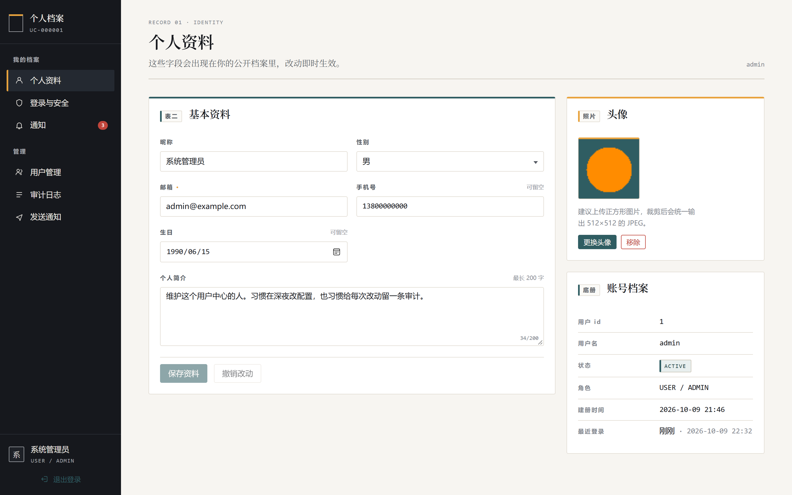 | 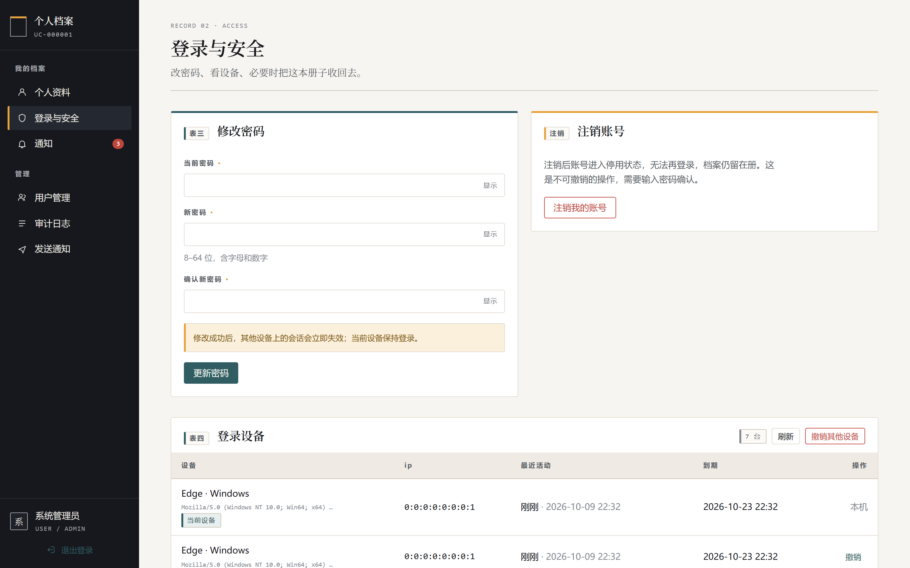 |

**通知与管理后台**：状态用印章而不是彩色胶囊；统计是一整条计数牌横带，不是四张圆角卡片。

| 通知中心 | 用户管理 |
|---|---|
| 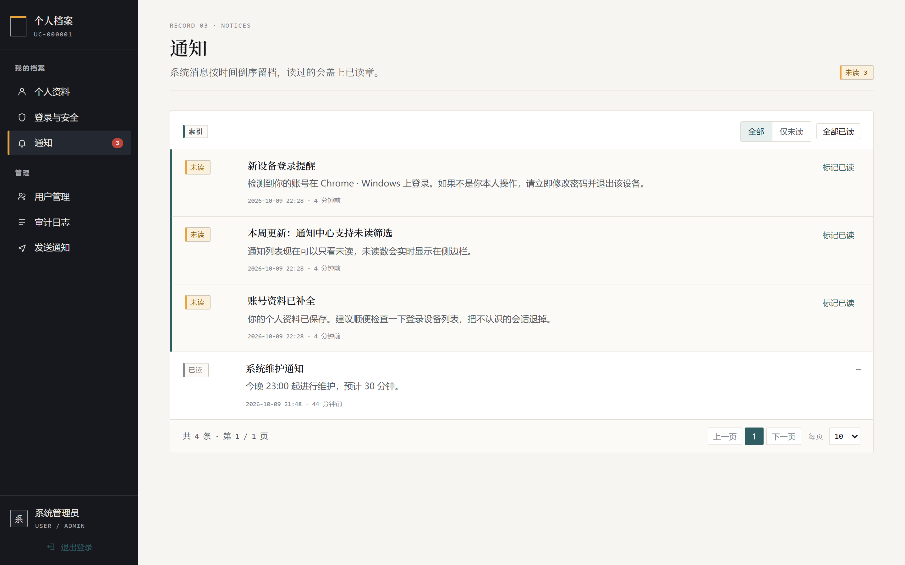 | 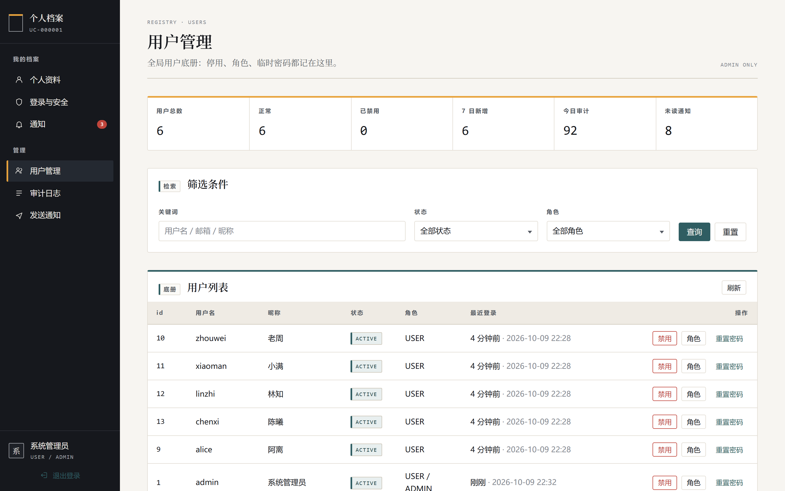 |

| 审计日志 | 发送通知 |
|---|---|
| 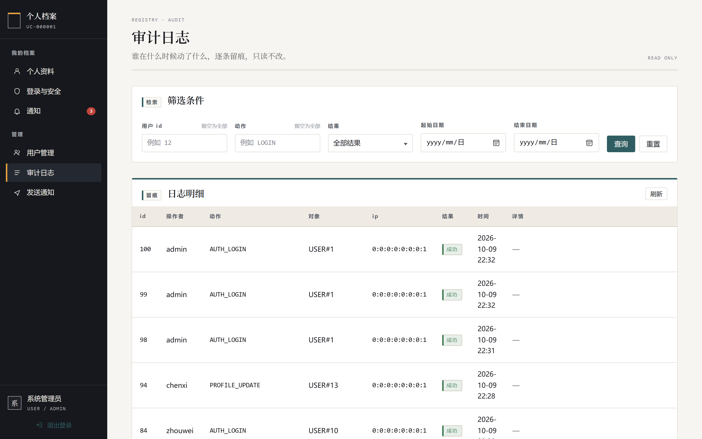 | 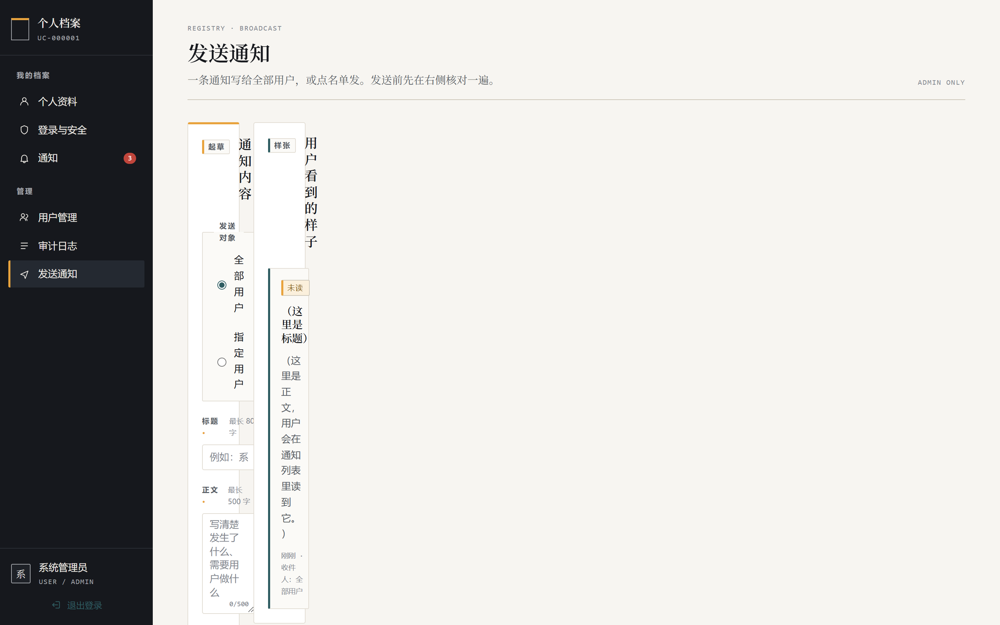 |

| 404 / 无权限页 |
|---|
| 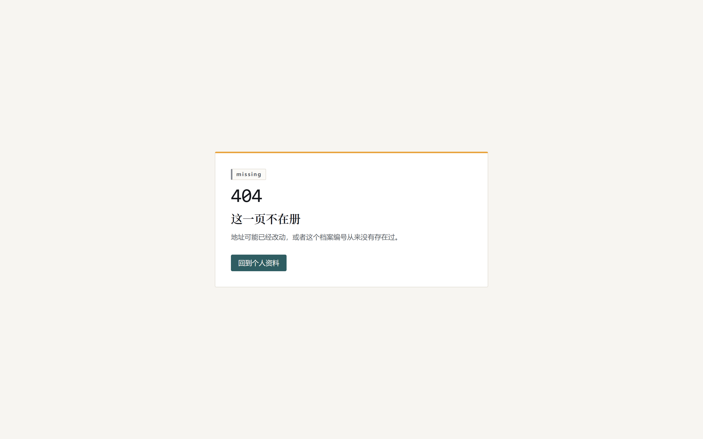 |

<details>
<summary><b>手机视口（390 × 844）</b> — 侧栏折叠成顶部图标条，表格横向滚动</summary>

| 登录 | 注册 | 个人资料 |
|---|---|---|
| 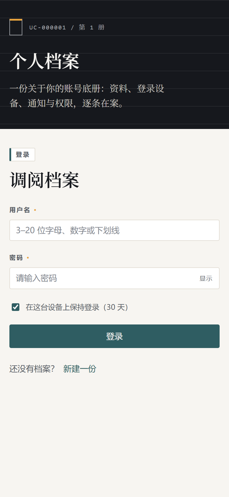 | 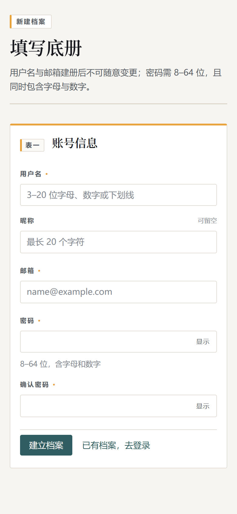 | 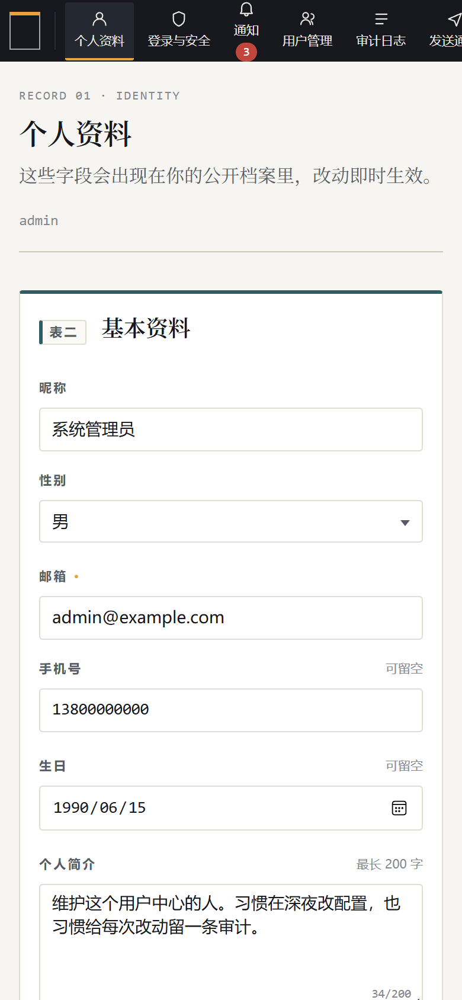 |

| 登录与安全 | 通知 | 用户管理 |
|---|---|---|
| 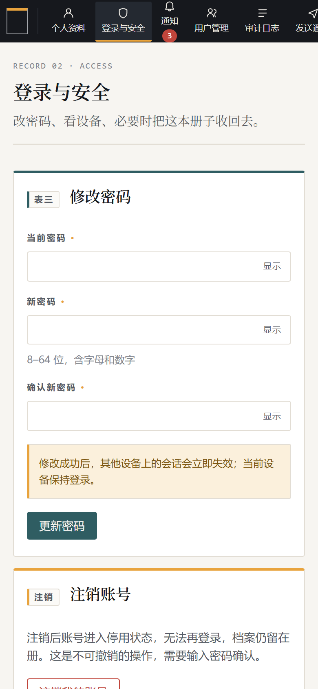 | 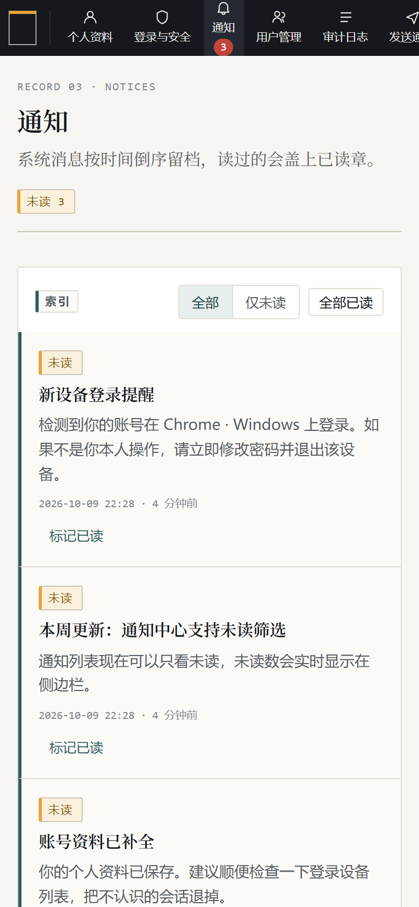 | 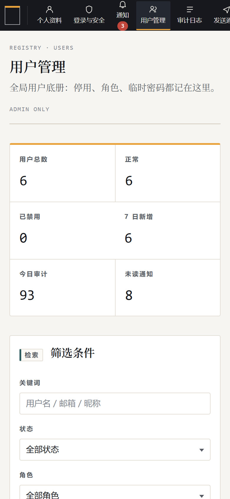 |

| 审计日志 | 发送通知 | 404 |
|---|---|---|
| 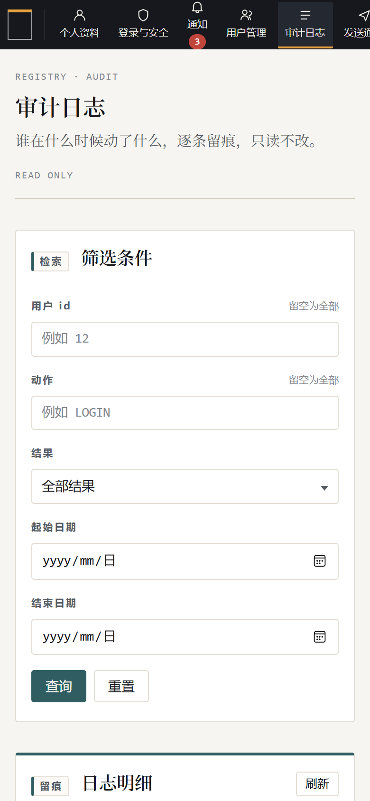 | 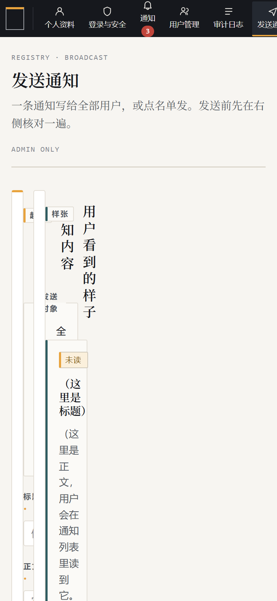 | 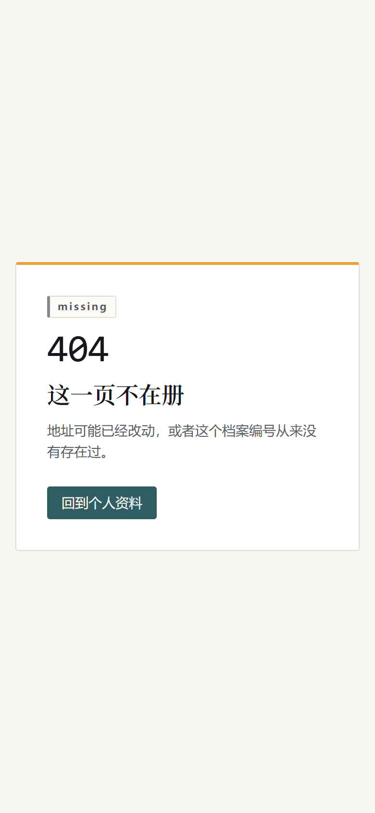 |

</details>

> 所有截图都由 Playwright 驱动本机 Edge 真机拍摄（`readme-image/`），不是手绘稿也不是拼贴。

---

## 关于这次「第一次 Vibe Coding」

这个项目是**我和 AI 一起、在一个会话里从零写完的**，也是我第一次正儿八经地用 vibe coding 的方式做完整项目。
把过程和结论写下来，因为它比项目本身更有意思。

### 谁做了什么

| | 人 | AI |
|---|---|---|
| 需求 | 定技术栈（Java + Vue + MySQL）、选功能范围、定验收清单 | — |
| 设计 | 定「不要模板脸」这条底线 | 出设计方向、写设计变量、定三个页面的具体做法 |
| 编码 | — | 后端 75 个 Java 文件 3155 行、测试 8 个文件 844 行、前端 50 个文件 6621 行、3 个脚本、4 份文档 |
| 验收 | 打开浏览器点一遍、看设计对不对味 | 跑 `mvn clean verify`、前端测试与构建、66 项端到端冒烟、用 Playwright 自己截图自查 |

### 两个只有"真跑"才会暴露的坑

1. **登录失败计数被事务吃掉了**。`login()` 上挂着 `@Transactional`，密码错误时抛异常，事务一回滚，
   "失败次数 +1"和失败审计**一起被撤销**——结果是连错 5 次永远不会锁定，锁定策略形同虚设，
   而单元测试完全发现不了（单测不会去数据库里核对计数）。修法是 `noRollbackFor = BizException.class`。
   这是先写完接口、再用真 HTTP 打一遍冒烟才炸出来的。
2. **Windows PowerShell 5.1 的编码连环坑**。`Invoke-WebRequest` 会按系统 ANSI 代码页解码响应体，
   中文和 emoji 全变问号；对 `application/vnd.spring-boot.actuator.v3+json` 又返回 `byte[]` 而不是字符串；
   `.ps1` 文件如果没带 UTF-8 BOM，中文会把整个脚本的语法打崩。最后冒烟脚本改成自己用
   `HttpWebRequest` + 显式 UTF-8 解码、Cookie 自己管，才稳定下来。

### 我的结论

**vibe coding 的瓶颈不在写代码，在验收。** AI 可以把两个小时写不完的代码在十分钟内铺完，
但它同时也会很自信地把 `@Transactional` 这种坑一起铺进去。所以这个仓库里，
测试和冒烟脚本的分量比一般的 demo 重得多：

- 后端 **21 个单元测试 + 23 个集成测试**（集成测试真连 `user_center_test` 库、走完整 Security 过滤器链）
- 前端 **31 个单元测试** + `vue-tsc` 类型检查
- **66 项端到端冒烟断言**，`scripts/smoke.ps1` 一条命令跑完，失败即非 0 退出

也正因为如此，这份代码仍然带着明显的 AI 痕迹，我不打算掩饰：

- 服务类偏胖（`AuthService`、`AdminUserService` 一个类里塞了不少职责），还能再拆；
- 头像裁剪那块**没有单测**（jsdom 跑不了 canvas），只有代码级保证；
- 错误码表可以再收敛，有些码目前只有一处用到；
- 界面只做了浅色，深色模式没做。

**欢迎拍砖，提 Issue 就行。**

---

## 功能

| 模块 | 具体能力 |
|---|---|
| 注册 / 登录 / 登出 | 用户名或邮箱登录、BCrypt 存密码、连续 5 次失败锁定 10 分钟、refresh token 每次刷新轮换 |
| 个人资料 | 昵称、邮箱、手机号、性别、生日、简介；空字符串表示清空；唯一冲突返回 409 |
| 头像 | 前端 512×512 裁剪后上传；服务端按魔数 + 像素上限校验、UUID 命名落盘、旧文件自动清理 |
| 账号安全 | 改密码（踢掉其他设备）、登录设备/会话列表、退出指定设备、退出其他设备、注销账号 |
| 角色与权限 | `ROLE_USER` / `ROLE_ADMIN`，方法级 `@PreAuthorize` + 前端路由守卫双保险 |
| 用户管理后台 | 分页检索（关键字/状态/角色）、启用停用、改角色、重置密码、概览统计 |
| 操作审计 | `@Audit` 切面 + 服务内显式记录；登录、改密、管理动作全留痕，可按用户/动作/时间/成败过滤 |
| 站内通知 | 未读数、列表（可只看未读）、单条已读、全部已读、管理员定向或全体群发 |

### 几个实现上的讲究

- **access token 只在浏览器内存里**，refresh token 放 httpOnly + SameSite Cookie，服务端只存它的 SHA-256；
- **每个已认证请求都会校验会话是否还有效**，所以"退出其他设备""改密码""账号被停用"都是**立即生效**的，
  不用等 30 分钟的令牌自然过期（代价是每请求一次主键查询，规模上来可以加缓存）；
- **防图片解压炸弹**：先用魔数判类型，再用 `ImageReader` 只读头部拿像素尺寸，超限的图在分配内存之前就被拦下；
- **审计日志永不写密码、令牌、Cookie**；管理员重置密码返回的临时密码只出现一次、不落库。

## 技术栈

**后端**：Java 21 · Spring Boot 3.5.16 · Spring Security 6 · MyBatis-Plus 3.5.17 · MySQL 8 · JJWT 0.12.7 · springdoc-openapi
**前端**：Vue 3.5 · Vite 7 · TypeScript 5 · Pinia 3 · Vue Router 4 · axios · cropperjs（无 UI 框架）

## 快速开始

**前置**：JDK 21、Maven 3.9+、MySQL 8、Node 20+ 与 pnpm。

```bash
# 1) 建库建账号（只需一次，不会动你机器上已有的库）
mysql --host=127.0.0.1 --port=3306 --user=root --password < scripts/db-init.sql

# 2) 本地配置（数据库密码、JWT 密钥；该文件已被 .gitignore 忽略）
cp backend/src/main/resources/application-local.yml.example \
   backend/src/main/resources/application-local.yml

# 3) 起服务（前后端各一个窗口）
pwsh -File scripts/dev.ps1
```

或者分开起：

```bash
cd backend  && mvn spring-boot:run      # http://localhost:8080  (接口文档 /swagger-ui.html)
cd frontend && pnpm install && pnpm dev # http://localhost:5173
```

表结构不用手动建：后端启动时执行 `db/schema.sql`（全 `CREATE TABLE IF NOT EXISTS`）与 `db/seed.sql`（幂等），
「代码即结构」，重复启动无副作用。

**默认账号**：`admin` / `Admin@12345`（可用环境变量 `UC_ADMIN_PASSWORD` 覆盖）。**第一次登录后请立刻改密码。**

> 生产环境请用环境变量覆盖敏感项：`UC_DB_PASSWORD`、`UC_JWT_SECRET`（HS256 要求 ≥ 32 字节）。

## 测试与验收

```bash
cd backend  && mvn clean verify                 # 21 单元 + 23 集成测试
cd frontend && pnpm test -- run && pnpm build    # 31 单元测试 + vue-tsc + 构建
pwsh -File scripts/smoke.ps1                    # 66 项端到端断言（需后端已在 8080 运行）
```

三个套件在本机的最新结果：**全绿**。`smoke.ps1` 覆盖健康检查、注册（含重复与弱密码）、
令牌签发与轮换、无令牌/伪造令牌 401、资料更新（含 emoji 与空值清空）、头像上传与公开访问、
伪装图片被拒、会话列表与退出其他设备、改密码后旧密码失效、通知未读与全部已读、
普通用户访问管理接口 403、管理员停用/恢复用户、被停用用户登录 403、管理员不能停用自己 409、
群发通知、审计日志可查、登出。

## 目录结构

```
user-center/
├─ backend/          Spring Boot 服务（com.example.usercenter）
│  ├─ src/main/java/…   common / config / security / storage / audit / entity / mapper / dto / service / controller
│  ├─ src/main/resources/db/{schema.sql,seed.sql}
│  └─ src/test/java/…   单元测试 + MockMvc 集成测试（真连 user_center_test）
├─ frontend/         Vue 3 应用（设计变量集中在 src/styles/tokens.css）
├─ readme-image/     README 用截图（Playwright 真机拍摄）
├─ scripts/
│  ├─ db-init.sql    建库建账号（一次性）
│  ├─ dev.ps1        一键起前后端
│  └─ smoke.ps1      端到端冒烟，失败以非 0 退出
└─ docs/
   ├─ api.md         接口清单、错误码、鉴权约定
   ├─ run.md         环境、配置与排错
   └─ design-brief.md 设计主张与设计变量全表
```

更详细的内容看这几份文档：[接口文档](docs/api.md) · [运行与排错](docs/run.md) · [设计说明](docs/design-brief.md)。

## 已知限制

- **头像只支持 JPEG / PNG**：JDK 自带 ImageIO 没有 WebP 解码器，前端裁剪后本来也统一输出 JPEG。
- **不做深色模式**：只维护了一套色板，不想做"半套主题"。
- **通知是轮询式的**：前端定时取未读数，没有做 SSE / WebSocket 推送。
- **没有 Docker、没有 CI**：本地跑起来最容易；容器化与流水线留给后面。
- **头像裁剪没有单测**：jsdom 里跑不了 canvas，只有代码级保证。

## 版本与路线图

**v0.1.0** — 首个可用版本：8 个功能模块全部打通，44 个后端测试 + 31 个前端测试 + 66 项冒烟全绿，文档齐全。

后面想做的事（不承诺顺序，也欢迎你投票）：

- [ ] `AuthService` / `AdminUserService` 拆分，把审计与通知的副作用从业务里抽出来
- [ ] 头像裁剪补测试（换 happy-dom 或直接上 Playwright 组件测试）
- [ ] 深色模式（这次刻意没做，要做就做完整的一套）
- [ ] 通知的 SSE 推送，替掉轮询
- [ ] Dockerfile + docker-compose（MySQL + 后端 + 前端）
- [ ] GitHub Actions：把 `mvn clean verify`、`pnpm test`、`smoke.ps1` 串成 CI
- [ ] 选定并加上开源许可证（**目前仓库还没有 LICENSE，默认保留所有权利**）

## 反馈

发现问题、有想法、或者觉得哪里写得蠢，都欢迎：

- 提 [Issue](https://github.com/VekearYi/user-center/issues)——跑不起来的报错请带上 `traceId`（错误响应里有，也能在响应头 `X-Trace-Id` 找到），能直接对上服务端日志；
- 安全相关的问题请**不要**公开提 Issue，先私下联系。

## 许可

暂未选定许可证（v0.1.0）。在加上 LICENSE 之前，默认保留所有权利。
